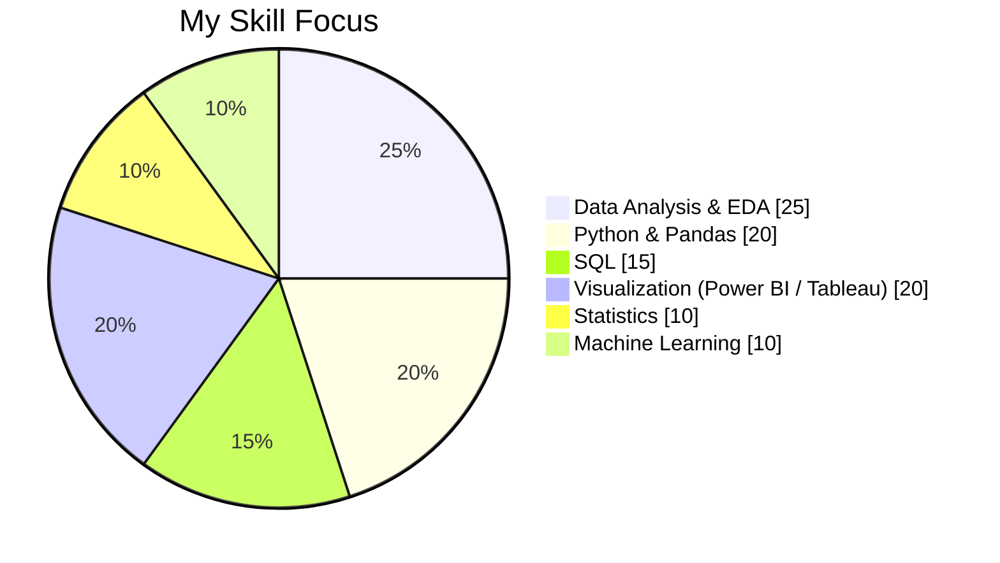
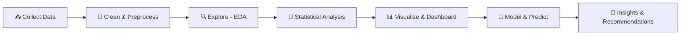
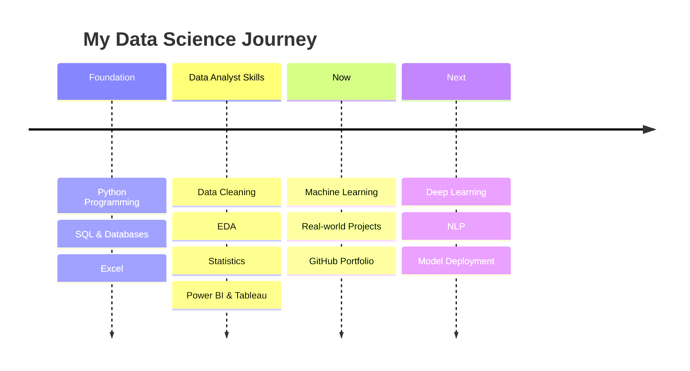

  

 

---

## 👩‍💻 About Me

> *"Data is only valuable when it leads to a decision."*

I'm **Ayushi**, an **MCA (1st Year)** student at **GMN College** with a strong foundation in **data analysis** and a clear goal: to become a **Data Scientist**.

I enjoy working with messy real-world data, uncovering the story hidden inside it, and presenting insights that people can actually act on.

| | |
|---|---|
| 🎓 **Education** | Master of Computer Applications (MCA), GMN College |
| 🔭 **Currently Building** | Machine Learning projects & interactive dashboards |
| 🌱 **Currently Learning** | Machine Learning, Deep Learning, NLP, Model Deployment |
| 💼 **Looking For** | Data Analyst / Data Science internships & entry-level roles |
| ⚡ **Strengths** | Analytical thinking, problem solving, data storytelling, quick learner |

---

## 🛠️ Skills & Tech Stack

  

### 🧠 Core Competencies

| Domain | What I Do |
|---|---|
| 🧹 **Data Cleaning & Preprocessing** | Missing values, duplicates, outliers, data type fixes, feature engineering |
| 🔍 **Exploratory Data Analysis** | Univariate & bivariate analysis, correlation, trend and pattern detection |
| 📐 **Statistics** | Descriptive & inferential statistics, probability, hypothesis testing |
| 🗄️ **SQL** | Joins, subqueries, CTEs, window functions, aggregations |
| 📊 **Data Visualization & BI** | Power BI, Tableau, DAX, KPI dashboards, Matplotlib, Seaborn |
| 🤖 **Machine Learning** | Regression, classification, clustering, model evaluation |
| 🗣️ **Data Storytelling** | Turning numbers into clear, business-ready insights |

### 📈 Skill Distribution

*(Adjust the numbers to match your own strengths.)*

---

## 🔄 How I Work

---

## 🚀 Featured Projects

> Replace each placeholder with your own project details, numbers and links.

<table>
<tr>
<td width="50%" valign="top">

### 📈 Sales Performance Dashboard
**Problem:** Find revenue drivers and weak segments in sales data.
**What I did:** Cleaned data in Python, performed EDA, built an interactive Power BI dashboard.
**Result:** *[e.g. Top 3 categories drive 62% of revenue]*

`Python` `Pandas` `Power BI` `DAX`

🔗 [View Project](https://github.com/your-username/sales-dashboard)

</td>
<td width="50%" valign="top">

### 🤖 Customer Churn Prediction
**Problem:** Predict which customers are likely to leave.
**What I did:** Feature engineering, trained Logistic Regression & Random Forest, evaluated with ROC-AUC.
**Result:** *[e.g. 87% accuracy, 0.91 ROC-AUC]*

`Python` `Scikit-learn` `Seaborn`

🔗 [View Project](https://github.com/your-username/churn-prediction)

</td>
</tr>
<tr>
<td width="50%" valign="top">

### 🗄️ SQL Business Analysis
**Problem:** Answer key business questions on orders and customers.
**What I did:** Wrote complex queries using joins, CTEs and window functions.
**Result:** *[e.g. Found monthly growth and customer retention trends]*

`MySQL` `SQL` `Excel`

🔗 [View Project](https://github.com/your-username/sql-analysis)

</td>
<td width="50%" valign="top">

### 🔎 Exploratory Data Analysis Case Study
**Problem:** Understand patterns in a public dataset (e.g. Kaggle).
**What I did:** Cleaned data, found correlations, built insightful visualizations.
**Result:** *[e.g. Discovered X factor strongly impacts Y]*

`Python` `Matplotlib` `Seaborn` `Jupyter`

🔗 [View Project](https://github.com/your-username/eda-case-study)

</td>
</tr>
</table>

---

## 💼 Experience

> Add your real experience here. Internships, freelance work, college projects, volunteering and club activities all count.

### 🔹 *[Role / Title]* — *[Company / Organization]*
`MM/YYYY – MM/YYYY`
- Analyzed *[dataset / problem]* using **Python and SQL** to *[achieve result]*
- Built *[dashboard / report]* that helped *[team / stakeholder]* to *[outcome]*
- Improved *[process / metric]* by *[x%]*

### 🔹 *[Academic / Self-Driven Project Experience]* — *GMN College / Self*
`MM/YYYY – Present`
- Practiced the complete data analysis workflow on real-world datasets
- Built end-to-end projects covering **data cleaning, EDA, visualization and ML**
- Documented projects on GitHub with clear READMEs and reproducible notebooks

---

## 🎓 Education

| Degree | Institute | Duration | Status |
|---|---|---|---|
| **MCA** (Master of Computer Applications) | GMN College | *[Year – Year]* | 1st Year (Ongoing) |

---

## 🏆 Certifications & Achievements

- 🎖️ *[Certification name]* — *[Platform: Coursera / Google / Microsoft / NPTEL]*
- 🎖️ *[Certification name]* — *[Platform]*
- 🏅 *[Hackathon / Kaggle competition / College achievement]*

---

## 🗺️ Learning Journey

---

## 📊 GitHub Analytics

 

 

 

---

## 🤝 Let's Work Together

I'm actively looking for **internships and entry-level opportunities** in **Data Analytics and Data Science**. If you're hiring, or want to collaborate on a data project, I'd love to connect.

📧 **your-email@gmail.com** &nbsp;|&nbsp; 🔗 **[LinkedIn](https://www.linkedin.com/in/your-linkedin/)** &nbsp;|&nbsp; 🌐 **[Portfolio](https://your-portfolio-link.com)**

 

### ⭐ *Thanks for visiting my profile!* ⭐

